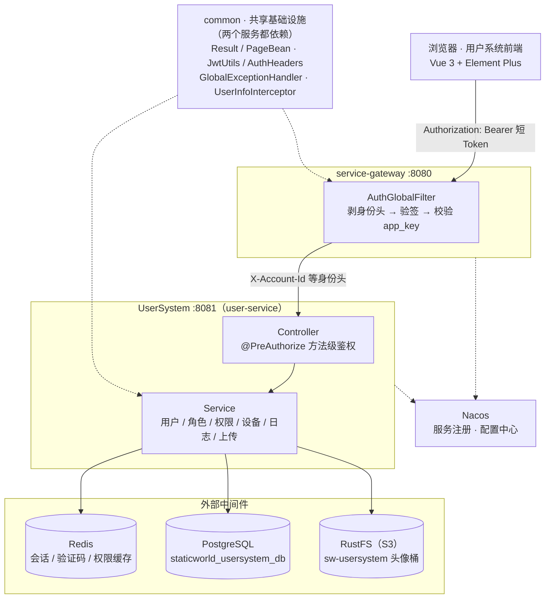
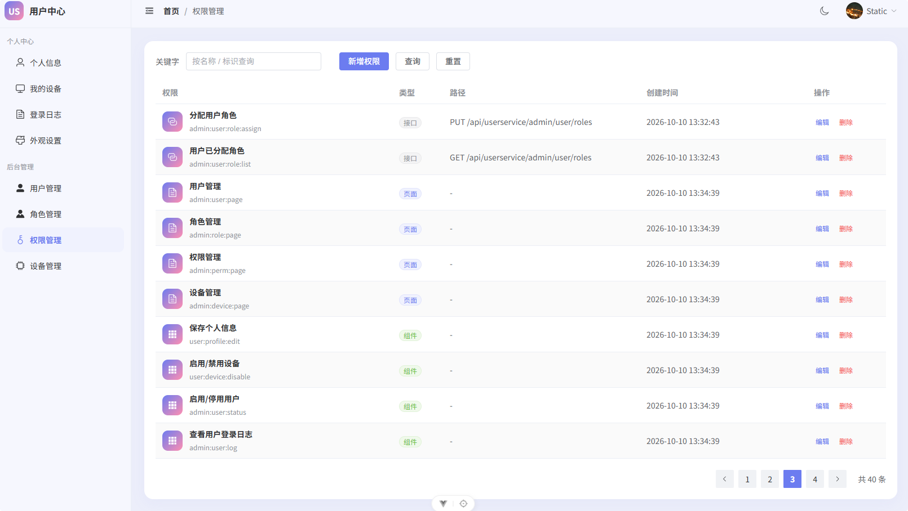
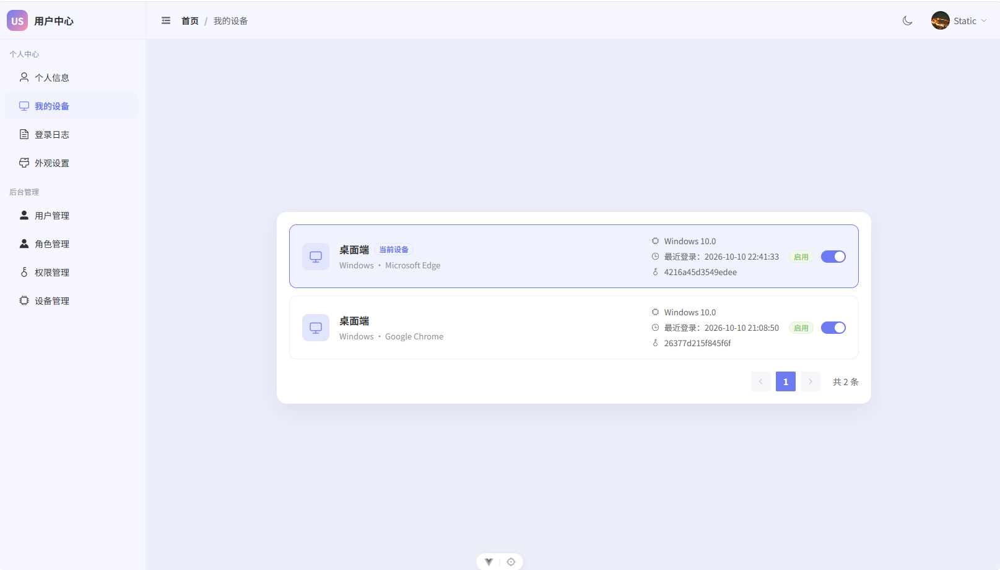
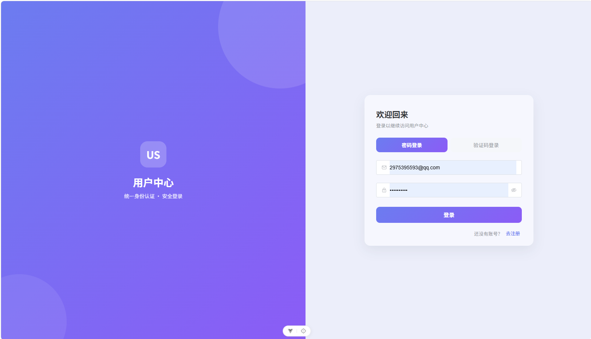

# StaticWorld——用户系统篇

【前端仓库地址】：https://github.com/XD-xiao/StaticWorldWeb.git

用户系统是一种你注定要写第二遍的东西。

第一次做的时候还挺有意思：设计用户表、密码加密、发验证码、做一个登录页。第三次做的时候，你已经在抄自己上一次的代码了，而且每次抄错的地方都一样——权限点对不上、Token 过期没处理、设备管理忘了做。

前端那篇 [《我给自己造了一份前端项目模板》](#/posts/my-vue-template) 讲的是怎么把后台前端的"老几样"提前装好。前端有了，后端还欠着一份。这次我把后端也整理了出来，项目内部代号 **StaticWorld**，仓库用的是那个模板仓库 `SpringCloudTemplate`。

它不是用户中心中间件，也不是什么框架，就是一套**能直接拿来改的骨架**：注册登录、会话、角色权限、设备、登录日志、头像上传都有，剩下的业务你自己填。

这篇不打算把增删改查铺开写一遍——那种内容看代码更快。我只挑四件我认为真正值得讲的：双 Token 怎么分工、身份怎么在服务之间传、权限怎么算和怎么跟代码对账，以及我明知不完美但先这么定的地方。

## 先看清这四块积木

先看全貌——这张图是后面所有内容的坐标：



后端是 Maven 多模块，一共四个模块，职责切得比较干净：

| 模块 | 职责 | 依赖谁 |
| --- | --- | --- |
| `common` | 共享基础设施：统一返回体 `Result`、全局异常处理、Jackson 配置、JWT 工具、身份模型、MVC 拦截器 | 无 |
| `service-api` | 服务间调用的契约（Feign 客户端 + 透传身份头的拦截器） | `common` |
| `service-gateway` | 网关 `:8080`：认证、路由、跨域 | `common` |
| `UserSystem` | 用户服务 `:8081`：用户 / 角色 / 权限 / 设备 / 日志 / 文件上传 | `common`、`service-api` |

技术栈都是熟脸，没什么冷门依赖：

| 层 | 选型 |
| --- | --- |
| 基础 | Java 17、Spring Boot 3.2.0、Spring Cloud 2023.0.0 |
| 注册与配置 | Spring Cloud Alibaba 2023.0.0.0-RC1（Nacos 2.3.0） |
| 持久化 | PostgreSQL + MyBatis-Plus 3.5.5 |
| 缓存 / 会话 | Redis（Lettuce） |
| 认证 | jjwt 0.12.6、Spring Security 6.2.0 |
| 对象存储 | AWS SDK for Java v2（对接 S3 兼容的 RustFS） |
| 前端 | Vue 3.5、Vite 7、Element Plus、Pinia、Axios |

在这堆选型之上，整个系统只有**三条设计主张**，后面每一节其实都在解释它们：

1. **网关只认证，不鉴权。** 网关只回答"你是谁"，不回答"你能不能"。
2. **权限绝不进 Token。** 算权限是服务端每一次请求的事。
3. **代码是权限清单的唯一来源，数据库向代码对齐。** 人只维护一处，机器负责对账。

## 认证：两根 Token，两把密钥

几乎所有自研登录系统的第一版都是这样：登录成功，返回一个 Token，前端存起来，过期了就让用户重新登录。

加个 Refresh Token 也不难。难的是想清楚**这两根 Token 各自应该承担什么风险**。StaticWorld 的分工是这样的：

| 对比项 | 短 Token（Access） | 长 Token（Refresh） |
| --- | --- | --- |
| 作用 | 每个请求的通行证 | 唯一用途：换新的短 Token |
| 签名密钥 | `jwt.secret`（网关和用户服务都持有） | `jwt.refresh-secret`（只有用户服务持有） |
| 载荷 | `account_id`、`device_id`、`app_key`、`roles` | 只有 `account_id`、`device_id`、`jti` |
| 有效期 | 8 分钟 | 15 天（滑动过期） |
| 存放位置 | 响应体，前端存 localStorage | HttpOnly Cookie，JS 读不到 |
| 服务端是否记录 | 不记录（无状态） | Redis：`auth:session:{userId}:{deviceId}` |

第一件事，**为什么是两把密钥**。短 Token 每次请求都要验签，所以网关必须持有它的密钥；密钥在越多人手里越危险。而长 Token 能换出全新身份，泄露的后果比短 Token 严重得多——那就给它单独一把密钥，只留在用户服务里。网关即使被拿下，也伪造不出一个能刷新会话的长 Token。

第二件事，**为什么长 Token 放 Cookie、短 Token 放 localStorage**。这看起来自相矛盾，其实是各承担一种风险：短 Token 前端每个请求都要主动带上，放 Cookie 就得处理 CSRF，索性放 localStorage，代价是 XSS 可以读走它；长 Token 恰恰相反——它只在刷新这一个动作里被用到，前端完全不需要读它，那就放进 HttpOnly Cookie，XSS 拿不到，路径还限制在 `/api/userservice/public`，只有那几个公开接口会带上它。

**一长一短，各承担一种风险，而不是"都塞进 localStorage 最省事"。**

### 长 Token 只做一件事：证明"这次刷新是它本人"

这是我在这套系统里最想推荐的一个设计。

长 Token 不是一张"15 天内一直有效的票"。它是一张**一次性**的票：每次刷新，服务端都会生成新的 `jti`（票据编号），把 Redis 会话里的 `activeJti` 换掉。于是如果有人拿一张**已经用过的**长 Token 来刷新——不管它是被偷了、还是被重放了——服务端立刻能判断出"这张票已经用过了"，直接删掉整个会话。

判断逻辑分三步：读会话、比对 `activeJti`、写回新值。这三步必须在 Redis 里**原子**完成，否则两个并发刷新会同时通过比对，两张新票一起发出去，重放检测就形同虚设。所以用一段 Lua 脚本兜住（下面是判断逻辑部分，完整脚本还包含角色回写和 TTL 参数）：

```lua
local key = KEYS[1]
local expectedJti = ARGV[1]
local newJti = ARGV[2]
local json = redis.call('GET', key)
if not json then
  return -1
end
local ok, session = pcall(cjson.decode, json)
if not ok or type(session) ~= 'table' or session['activeJti'] ~= expectedJti then
  redis.call('DEL', key)
  return -2
end
session['activeJti'] = newJti
redis.call('SET', key, cjson.encode(session), 'EX', ttlSeconds)
return 1
```

返回值被刻意设计成三种含义，调用方按语义分别处理：

```java
long result = refreshTokenCache.rotate(userId, deviceId, info.jti(), newJti, roleKeys, refreshTtlSeconds);
if (result == -1) {
    throw new UnauthorizedException("会话已过期，请重新登录");
}
if (result == -2) {
    // 旧票据又出现了一次：要么被偷了，要么被重放了，直接销毁这个会话
    System.err.println("安全事件：refresh token 重放检测命中 -> userId=" + userId);
    throw new UnauthorizedException("token 已被使用，请重新登录");
}
```

`-1` 是"会话不存在"，`-2` 是"这张票已经被用过"——后者会顺手把整个会话删掉，属于**宁可错杀**：一旦出现重放，就认为这个设备的凭证已经泄露，让用户重新登录，比让攻击者继续持有有效凭证要好。

> 换成通用的话说：这叫 **refresh token rotation + reuse detection**，是 OAuth 2.0 安全实践里最值得抄的一条。绝大多数自研登录系统的长 Token 就是一张长期有效的票，一旦泄露，攻击者可以安静地用到到期，用户毫无感知。

### 前端也得配合：并发 401 只能刷新一次

这里是整套设计里最容易被忽略的一环，也是我认为"前后端耦合"最有意思的例子。

想象一个真实场景：用户打开页面，同时发出了 5 个请求。恰好这时短 Token 过期了——5 个请求一起 401，前端的"自动刷新"逻辑就会发起 **5 次刷新**。服务端刚把 `jti` 换掉，后 4 次拿的是同一个旧 Cookie，于是全部命中重放检测，**整个会话被删，用户莫名其妙被踢下线**。

服务端越严格，客户端就越必须守规矩。所以前端保证并发 401 只刷新一次：

```js
// 单例刷新：并发多个 401 只发起一次（服务端有重放检测，避免误触发）
let refreshPromise = null
function refreshAndUpdateAuth() {
  refreshPromise ??= refreshToken()
    .then((result) => {
      useAuth().setAuth(result || {})
      return result?.accessToken || ''
    })
    .finally(() => {
      refreshPromise = null
    })
  return refreshPromise
}
```

`??=` 让并发的调用共享同一个 Promise，全部拿到结果后再各自重试自己的原请求；`finally` 里清空，保证下次真的还有一次刷新机会（而不是缓存住一个失败的 Promise 把所有后续请求锁死）。

另外三个细节也是同一个思路下的产物：刷新用的是**一个不带拦截器的独立 axios 实例**，所以刷新接口自己返回 401 时不会再次触发刷新、形成死循环；每个请求带一个 `_retry` 标记，只允许重试一次；登录态清空和跳转登录页也有一个 `redirecting` 闩锁，让并发 401 只弹一次提示、只跳一次页面。

### 顺带一个精度坑

主键用的是雪花 ID，19 位十进制数，早就超过了 JavaScript 能安全表示的整数上限（`2^53 - 1`）。如果直接以数字形式过 JSON，前端拿到手的会是一个**悄悄变了个值**的 ID——不报错，就是查不到数据。

后端的做法是全局把 `Long` 序列化成字符串：

```java
// long -> string，避免前端雪花 ID 精度丢失
jacksonObjectMapperBuilder.serializerByType(Long.class, ToStringSerializer.instance);
```

Redis 里也一样：Lua 的 `cjson` 会把大整数当浮点数处理，所以写进会话的 `userId` 也是字符串。

**只要数据要穿过 JSON 或者某个脚本引擎，就不要假设"数字还是那个数字"。** 这类问题不会抛异常，只会让你在某天下午对着一条查不到的记录怀疑人生。

## 网关：先剥头，再验签，最后重新发身份

网关的活儿听起来很简单：验一下 Token，把请求转给后面的服务。真正需要注意的其实是**顺序**。

下游服务不认识 JWT。它们只认几个 HTTP 头：`X-Account-Id`、`X-Device-Id`、`X-App-Key`、`X-Roles`。这个设计的好处是每个服务不用各自维护密钥和解析逻辑，代价是——**如果谁能自己伪造这几个头，谁就是任何人**。

所以网关做的第一件事不是验签，而是**无条件清空所有身份头**：

```java
// 1. 无条件清除外部传入的身份头（白名单），防止绕过网关伪造身份。
//    放行路径同样必须清除，否则下游会误信客户端伪造的身份头。
ServerWebExchange sanitizedExchange = exchange.mutate()
        .request(builder -> builder.headers(headers ->
                headers.keySet().removeIf(AuthHeaders::isIdentityHeader)))
        .build();
```

注释里那句"**放行路径同样必须清除**"是这一步的关键。很多实现只对需要认证的路径做清理，而白名单路径直接放行——可白名单路径也会走到下游服务，攻击者只要往 `/public/xxx` 上塞一个 `X-Account-Id`，就能冒充任何人。这一步漏了，前面所有验签都白做。

清理之后才是验签流程：取 `Authorization: Bearer` 里的 Token、验签验过期、解码成统一的身份模型 `UserIdentity`，再核对 Token 里的 `app_key` 和这条路由是否匹配（`UserSystem: /api/userservice/**`），最后把身份字段重新写回请求头转给下游。

头名不是散落在各处的字符串，而是集中定义在一处，`claim` 名和头名成对登记：

| JWT claim | 下游请求头 |
| --- | --- |
| `account_id` | `X-Account-Id` |
| `device_id` | `X-Device-Id` |
| `app_key` | `X-App-Key` |
| `roles` | `X-Roles`（逗号分隔） |

这份白名单在三个地方被复用：网关剥头、网关写入身份、以及跨服务调用时 Feign 拦截器把当前请求的身份头原样转发给下一个服务。于是"新增一个身份字段"这件事，只需要改这一处定义。

最后是下游服务：Spring Security 无状态、CSRF 关闭、`/api/userservice/public/**` 放行，其余一律要求已认证。

### 这个设计成立的前提

必须说清楚：下游对身份头是**零校验**的，它完全信任网关。谁能直连 `8081`，谁就能自己写一个 `X-Account-Id` 冒充任何用户，验签、重放检测、权限缓存全部形同虚设。

这套设计成立的前提是"`8081` 不对外"——**用网络边界换来的实现简洁**。在小规模内网部署里这是常见且划算的取舍；但如果服务端口暴露在公网，或者内网里有不可信节点，就必须补上服务间认证（mTLS、内网签名头等）。我把它连同其他几处一起放在了文末的"不完美"里。

## 权限：算在每一次请求上，缓存成两级

权限模型是最经典的 RBAC，五张表：`sys_user`、`sys_role`、`sys_permission` 三张主表，加 `sys_user_role`、`sys_role_permission` 两张关系表。用户挂角色，角色挂权限点，没有继承、没有数据权限，够用且好懂。

权限点的命名规范定死了：`模块:实体:操作`，至少三段、全小写。两个约定俗成的后缀/前缀：

- `:me` 表示"只作用于自己"。`user:login:log:me`（只能看自己的登录日志）和 `user:login:log`（可以看任意用户的日志）是两个不同的权限点，接口路径不同，权限也不互相包含；
- `admin:` 前缀表示管理端操作，比如 `admin:role:list`。

`sys_permission` 里还有一个 `perm_type` 字段，把权限点分成三类：**1 页面、2 组件、3 接口**。这个字段看起来不起眼，却是后面那套"自动对账"机制的基础。



### 为什么权限不进 Token

把权限点塞进 Token 是最省事的做法：服务端验完签就能直接读，一次数据库都不用查。我没这么做，两个理由：

1. **权限会变，Token 不会。** 管理员今天收回了你某个权限，可你的 Token 还在有效期内——要么等它过期，要么维护一套 Token 黑名单。权限放进 Token，就等于把"授权状态"冻结在了签发的那一刻。
2. **Token 会膨胀。** 权限点会随业务增长，今天 20 个，明年 200 个，全都塞进每个请求都带着的 Token 里。

所以短 Token 里只有 `roles`，而 `roles` 只用于会话记账，**鉴权时根本不用它**。真正的权限每次请求现算，靠两级 Redis 缓存扛住性能：

| key | 内容 |
| --- | --- |
| `auth:user:{userId}` | 这个人的角色 id 列表 |
| `auth:role:{roleId}` | 这个角色的权限点列表 |

查一次请求就是两次缓存查询：userId → roleIds → permKeys。缓存的失效时机是精确的：

| 发生了什么 | 失效哪些 |
| --- | --- |
| 给某人换了角色 | `auth:user:{userId}` |
| 给某个角色换了权限 | `auth:role:{roleId}` |
| 增删角色 / 权限、代码同步权限点 | 全部清空（`SCAN` + `DEL`） |

算出来的权限点会被装成 Spring Security 的 `authorities`，于是控制器上可以直接写声明式的判断：

```java
@PreAuthorize("hasAuthority('user:info:get')")
```

### 401 和 403 的区别不是代码风格，是契约

这里有一个我认为很值得单独讲的细节。`UserInfoAuthFilter` 在构造认证信息时，**即使这个人一个权限都没有，也会给他一个"空权限的已认证身份"**：

```java
// 网关已校验 token，只要存在账号标识即视为已认证；
// 即使没有角色，也保留一个空权限的 Authentication，让 @PreAuthorize 走 403 而不是 401。
UserIdentity identity = UserIdentityCodec.read(request);
if (identity.isPresent()) {
    List<GrantedAuthority> authorities = loadAuthorities(identity);
    UsernamePasswordAuthenticationToken authentication =
            new UsernamePasswordAuthenticationToken(identity.userId(), null, authorities);
    SecurityContextHolder.getContext().setAuthentication(authentication);
}
```

如果偷懒一点——"没权限就不放认证信息"——会发生什么？一个只是权限不足的正常用户，会收到 **401**。而前端拦截器看到 401 的反应是"登录过期了，去刷新 Token"，刷新完还是 401，最后把他登出。一个"你没这个权限"的问题，被伪装成了"你没登录"，整条错误链路全乱了。

**401 的语义是"你没登录"，403 的语义是"你登录了，但没有这个权限"。** 这两个状态码不是装饰品，前端会据此做出完全不同的动作（刷新凭证 vs 提示无权限）。语义一旦被糊弄，错误处理就会层层跑偏。

## 让代码和数据库自己对账

这是整套系统里我最满意的一块，也是踩坑最多的部分。

麻烦在于：权限点天然有**三份清单**在互相追——后端代码里 `@PreAuthorize` 写的字符串、数据库 `sys_permission` 表里的记录、前端 `v-permission` 指令里写的字符串。任何一份改了，另外两份就过期了。时间一长，谁也说不清某个权限点到底还存在不存在。

StaticWorld 的做法是按类型分开管，然后让机器来对账：

| 权限点类型 | 谁维护 | 什么时候同步 |
| --- | --- | --- |
| 1 页面 | 前端 `src/permissions.js` | 构建时导出，再上传给后端 |
| 2 组件 | 前端 `src/permissions.js` | 同上 |
| 3 接口 | 后端 `@PreAuthorize` 注解 | 服务启动时扫描 |

### 后端：启动时扫自己的注解

`PermissionSyncRunner` 是个 `ApplicationRunner`，每次服务启动都会做一遍对账：从 `RequestMappingHandlerMapping` 里拿到所有接口方法，用正则把 `@PreAuthorize` 里的权限点抠出来：

```java
/** 匹配 hasAuthority('xxx') */
private static final Pattern HAS_AUTHORITY = Pattern.compile("hasAuthority\\('([^']+)'\\)");

/** 匹配 hasAnyAuthority('a','b') */
private static final Pattern HAS_ANY_AUTHORITY = Pattern.compile("hasAnyAuthority\\(([^)]*)\\)");
```

抠出来的权限点带着接口路径（比如 `POST /api/userservice/public/register`）一起 upsert 进 `sys_permission`，类型固定为 3；然后反查一遍——**库里存在、代码里已经没有的接口权限点会被删掉**，连角色绑定关系一起清干净。

注解里只能写英文标识符，给人看的名字由另一个注解 `@PermissionName("用户管理")` 提供。

### 前端：构建时审计，未登记就直接构建失败

前端同样只维护一份清单，`src/permissions.js`——**零依赖**，因为它要被 Vite 插件在 Node 侧直接加载。清单分两组，`permType` 由分组决定：

```js
export const pagePermissions = [
  { name: '用户管理', key: 'admin:user:page' },
  // ...
]

export const componentPermissions = [
  { name: '保存个人信息', key: 'user:profile:edit' },
  // ...
]
```

然后是 Vite 插件当监工，核心就两行——**双向**比对：

```js
const missing = [...used].filter(([key]) => !keys.has(key))   // 代码里用了但没登记
const dead = [...keys].filter((key) => !used.has(key))        // 登记了但代码里没人用
```

它的行为按时机分三种：

| 时机 | 行为 |
| --- | --- |
| `npm run dev` 启动 | 扫描 `src` 与清单比对，输出"使用 N 个 / 已登记 M 个"；两类问题都告警并给出 `文件:行号` |
| 保存源文件 | 重新审计，只输出问题项，不刷屏 |
| `npm run build` | 只要还有未登记的权限点，**直接构建失败**；否则导出 `dist/permissions.json` |

导出格式正好是后端能直接吃的：

```json
[
  { "permName": "用户管理", "permType": 1, "permKey": "admin:user:page" }
]
```

**"已登记但代码里没用到"这一半同样重要**——死权限能被揪出来，而不是烂在库里没人敢删。

### 两边汇合

前端构建产物通过一个上传接口回到后端，后端按 `permKey` upsert 类型 1/2 的权限点，删掉清单里已经没有的，最后清空权限缓存。于是这个环闭上了：

**前端清单 → 构建审计 → permissions.json → 上传 → 数据库 → 缓存失效 → 下一次请求生效。**

> 权限对不齐的本质，不是人粗心，而是**"约定"这种东西没有被机器检查**。凡是"必须遵守但没人检查"的约定，最后都会烂掉。解法很朴素：把清单收成唯一入口，然后把检查塞进构建和启动流程——**让它在打包时失败，而不是上线后某个按钮谁都点不了。**

顺便说两个防误判的细节，都是踩过才知道的：扫描要**排除清单文件自身**，否则"登记过"这件事本身会让所有死权限看起来都被使用了；扫描**只认带引号的完整权限点**，这样 `localhost:8080` 这种两段字符串不会被误判成权限点。

## 设备与登录日志

设备这块的设计核心是**把"设备"和"用户与设备的关系"拆成两张表**：

- `device` 存"这台设备是什么"：指纹、设备类型、操作系统、浏览器、UA；
- `user_device` 存"谁用过它"：用户 id、设备 id、启用状态、最近登录时间。

分开的好处是两边互不干扰：同一台电脑可以被多个账号登录，一个账号也可以有多台设备，都不会互相覆盖。

设备指纹由前端生成（`device-fingerprint-js`），存在 localStorage 里，登录时随请求带上。后端并不认识"浏览器"，它只认识这个字符串——所以严格说，**这是客户端自报的身份**，防不住有心人换一个指纹（这一点我也列在文末）。

**禁用设备 = 删会话。** 把 `user_device.status` 置 0 的同时，会删掉该设备在 Redis 里的会话；这台设备下次登录会被 403 拦住（"该设备已被禁用"）。而且重新登录**不会**把禁用状态"复活"——`bindUserDevice` 对已存在的关联只刷新最近登录时间，不动启用状态。这个细节看着小，但决定"禁用"到底有没有用。

登录日志记了 IP、时区、经纬度、登录方式（密码 / 验证码）。前端的「我的设备」页做了一件小事：当前设备是拿本地指纹和列表比对出来的，然后打上「当前设备」标记；启用/禁用的开关故意不用 `v-model`，而是 `:model-value` 配 `@change`——**等接口成功再翻转 UI**，避免"看起来成功了、其实失败了"。



## 前端：把约定写进代码

前端本身就是那套模板的具体实现，这里只挑三个和用户系统强相关的点。

**一、请求层统一处理 `Result<T>` 信封。** 后端所有接口都返回 `{ code, message, data, timestamp }`，约定 `code === 200` 才算成功。响应拦截器负责判断成功、剥掉 axios 那一层、并把失败消息统一弹出来——所以业务组件里几乎看不到错误提示代码，每个 `catch` 块都只有一行注释"拦截器已统一提示"。文件流响应（`blob` / `arraybuffer`）则原样直通，留给下载用。

**二、权限控制就是一行指令。** 页面权限交给路由 `meta.permission`，组件权限交给指令：

```vue
<!-- 拥有该权限点才显示 -->
<el-button v-permission="'admin:user:log'">查看日志</el-button>

<!-- 需全部满足 -->
<el-button v-permission.all="['admin:user:log', 'admin:user:device']">查看</el-button>

<!-- 无权限时禁用而非隐藏 -->
<el-button v-permission.disable="'user:device:disable'">停用</el-button>
```

实现上有两个刻意的选择。隐藏用的是 `display: none` 而不是销毁 DOM——权限变了能立刻恢复回来；重算则靠 `effectScope` + `watchEffect` 订阅权限仓库，所以登录、登出、静默刷新之后权限会**实时重算**，不需要手动刷新页面。开发期写了没登记过的权限点，控制台还会告警。

**三、登录态只有一个入口。** 业务代码不直接碰 store 字段，统一走 `useAuth()` 的 `setAuth()` / `clearAuth()`；持久化的 key 一律带 `app:` 前缀（`app:user`、`app:permission`、`app:config`）。这样"登录态存在哪里、叫什么名字"是可控的，而不是散落在十几个组件里。

另外从前端模板继承过来的两个习惯也还在：接口地址走运行时配置（`public/config.js` → 打包后的 `dist/config.js`，部署完用记事本就能改环境，不用重新打包）；`403` / `404` 是独立路由，不套 Layout，避免"没权限还给你一个侧边栏"。



## 也说说不完美的地方

我不想把它说成"一套就能上生产"。下面这些是我知道的边界，写出来比藏着好——也顺便说清楚每一条的代价在哪。

- **Access Token 无法主动撤销。** 登出和禁用只删 Redis 会话，短 Token 本身还在有效期内，最长有 8 分钟窗口能继续调用接口。想彻底解决就得引入黑名单或缩短 TTL，前者牺牲无状态，后者牺牲性能。
- **验证码偏弱。** 4 位数字、50 秒有效、没有尝试次数限制，而且为了方便调试还打印到控制台。生产至少要加尝试计数，再配图形验证码或频率限制。
- **登录日志只记成功。** 表里有个 `login_result` 字段，但目前只写成功记录——想看暴力破解的尝试就得补上失败分支。
- **密码走的是 query string。** 登录和注册接口是 `POST` 但参数放在 URL 上，会进服务器访问日志和浏览器历史。改成请求体是很小的工作量，但确实还没做。

**这些都是取舍，不是意外。** 每一处我都能说出"为什么先这样"，也能说出"要改的话从哪里下手"。我觉得这比假装它什么都能干要诚实。

## 最后

写这套东西的过程里，我觉得收获最大的不是某个具体技术点，而是一个挺朴素的观察：

**凡是靠人记性的约定，最后都会烂掉；把它变成构建或启动时的检查，它就能活很久。**

权限点的双向对账是这个道理，双 Token 的轮换是这个道理，前端清单"未登记就构建失败"也是这个道理。技术选型会过时，这种"让机器替人守约定"的思路可以一直用下去。

如果你也在做用户系统，或者正在被"权限点三份清单对不齐"折磨，希望这几段能给你一点参考。如果你有更好的做法——尤其是身份头跨服务传递这一段，我一直觉得还有更干净的方案——很欢迎聊一聊。
